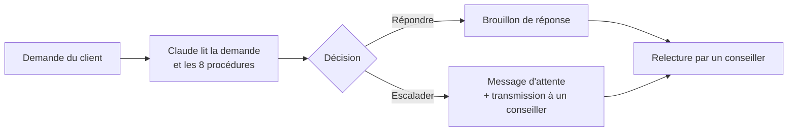

# Assistant de tri et de brouillons de réponses pour un support client

Projet de démonstration : un assistant (n8n + Claude) qui lit une demande client, décide s'il peut y répondre ou s'il faut la transmettre à un conseiller, et rédige un brouillon que le conseiller relit. Il est évalué comme on évaluerait un outil chez un client : avec une référence de comparaison, des jeux de test séparés, une mesure du coût et un journal des erreurs.

> **Tout est fictif.** L'entreprise (un distributeur de sport), ses procédures et toutes les demandes sont inventées. Aucune donnée d'un client réel n'a été utilisée. Les demandes ont été écrites par Claude (certaines à la demande de l'auteur, qui a relu et corrigé les étiquettes de la dernière série). Les résultats mesurent donc le comportement sur des cas inventés, pas sur un vrai flux.

## Ce que fait l'assistant

- Il applique **8 procédures fictives** (livraison, retours, garantie, paiement, modification de commande, produit, compte, réclamations), toutes écrites dans le prompt.
- Il ne promet ni geste commercial, ni exception, ni date non prévue, et escalade en cas de doute, de menace, de sécurité, de données personnelles ou de sujet hors procédures.
- Il renvoie un résultat structuré (procédure, décision, raison, brouillon). Si la réponse est illisible, il escalade par sécurité.
- **Il n'envoie rien tout seul** : un humain relit chaque brouillon.

## Résultats

Chaque chiffre est **mesuré** sur les jeux indiqués, avec **une seule exécution** par version. Ces jeux sont petits : un écart d'un ou deux cas ne prouve rien (le même prompt change de décision sur 1 ou 2 demandes d'un passage à l'autre).

| Jeu de données | Version | Bonnes décisions | Escalades repérées | Escalades inutiles |
|---|---|---|---|---|
| Test (64 demandes, 8 à escalader) | Baseline par mots-clés, sans IA | 51/64 (80 %) | 3/8 | 8 sur 56 |
| | Prompt v1, Haiku 5.5 | 58/64 (91 %) | 8/8 | 6 |
| | Prompt v2, Haiku 5.5 | 57/64 (89 %) | 8/8 | 7 |
| | Prompt v2.1, Haiku 5.5 | 58/64 (91 %) | 8/8 | 6 |
| | Prompt v2.1, Sonnet 5.5 | 64/64 (100 %) | 8/8 | 0 |
| Validation (16, dont 2 à escalader, jamais utilisé pour écrire le prompt) | v2.1, Haiku 5.5 | 14/16 | 2/2 | 2 |
| Cas limites (21, tous à escalader) | v1 / v2, Haiku 5.5 | 20/21 / 21/21 | 20 / 21 | – |
| Style « réel » (15, dont 9 à escalader) | v2.1, Haiku 5.5 et Sonnet 5.5 | 13/15 pour les deux | 7/9 | – |

À retenir :
- Le gain principal vient du passage des mots-clés à un modèle de langage, surtout sur les escalades (8/8 contre 3/8).
- Les versions 2 et 2.1 améliorent la **forme** des brouillons (salutation dans 100 % des cas, numéro de commande demandé quand il le faut), pas la précision des décisions.
- **Sonnet 5.5 n'escalade aucune demande à tort sur le jeu de test, contre 6 pour Haiku 5.5**, mais ne fait pas mieux sur les 15 demandes « style réel ». Son 64/64 est à lire avec prudence : deux étiquettes (D043, D055) étaient discutables, et deux de ses réponses restent contestables (voir le journal).
- Le score est mesuré par rapport à des étiquettes que j'ai écrites ; certaines sont discutables et sont documentées (jamais modifiées après avoir vu les résultats, sauf correction datée).

### Coût (mesuré à partir du solde du compte, précision d'un centime)

| Modèle | Coût par demande |
|---|---|
| Claude Haiku 5.5 | environ 0,001 $ (entre 0,0008 et 0,0013) |
| Claude Sonnet 5.5 | environ 0,012 $ (environ 13 fois plus) |

Le coût inclut la « réflexion » interne du modèle, facturée comme du texte de sortie. Hypothèse : monnaie en dollars, aucun autre appel entre deux relevés.

### Qualité des brouillons

40 brouillons de la v1 ont été notés avec une grille de 4 critères (exactitude, complétude, pertinence, utilité), **par un modèle d'IA**, puis 10 lignes ont été recontrôlées à la main (40 notes sur 40 identiques). Cet échantillon de contrôle est petit et facile : il ne prouve pas que la notation par IA soit fiable sur les cas difficiles. Après correction de 5 lignes, 24 brouillons sur 40 sont notés 4 sur 4 partout.

## Limites connues

- Données inventées par la même démarche que les procédures et le prompt : les résultats sont probablement trop favorables.
- Une seule exécution par version ; pas de mesure de la variation d'un passage à l'autre.
- Quelques demandes ont plusieurs procédures plausibles : l'étiquette « procédure attendue » y est arbitraire.
- Les brouillons contiennent parfois des conseils de bon sens absents des procédures (par exemple « ne plus utiliser la gourde par précaution ») : c'est la raison de la relecture humaine.
- Aucun test sur de vraies demandes, de vraies fiches produit ni de vrais systèmes de gestion des demandes.

Le détail est dans [`evaluation/journal_erreurs.md`](evaluation/journal_erreurs.md) (13 erreurs relevées, avec cause, correction et décision) et dans [`evaluation/comparaison_versions.md`](evaluation/comparaison_versions.md).

## Méthode

1. **Cadrage** : problème, périmètre et critères de réussite avant de construire ([`docs/cadrage.md`](docs/cadrage.md), [`docs/process.md`](docs/process.md)).
2. **Données** : 80 demandes synthétiques (64 test, 16 validation), 21 cas limites tous à escalader, 15 demandes « style réel ».
3. **Baseline** : un script de mots-clés, sans IA, pour savoir ce que vaut un outil simple.
4. **Évaluation** : la décision est comparée à l'étiquette ; la mesure clé est le taux d'escalades repérées (une règle « ne jamais escalader » obtiendrait 87,5 % de bonnes décisions mais 0 escalade repérée).
5. **Itérations** : v1, v2, v2.1 ; toute règle ajoutée l'est après analyse des erreurs, puis testée sur un jeu qui ne l'a pas inspirée (jeu de validation).
6. **Journal d'erreurs** : chaque erreur avec sa cause, la correction prévue et la décision prise.

## Contenu du dépôt

| Dossier ou fichier | Contenu |
|---|---|
| [`docs/`](docs/) | [Cadrage](docs/cadrage.md), [description du processus](docs/process.md) et [étude de cas](docs/etude_de_cas.md)|
| `data/procedures/` | Les 8 procédures fictives |
| `data/` | Demandes synthétiques (test et validation), cas limites, demandes « style réel » |
| `prompts/` | Prompts v1, v2 et v2.1 |
| `workflow/` | Export du workflow n8n et code des nœuds |
| `baseline/` | Script de référence par mots-clés |
| `evaluation/` | Résultats par version, notation des brouillons, contrôle humain, comparaison, journal d'erreurs |

## Reproduire

1. Compte n8n Cloud (l'essai gratuit suffit) et clé API Anthropic avec un petit crédit (quelques dollars suffisent).
2. Importer le workflow, coller le prompt voulu dans le nœud « Message a model », renseigner la clé.
3. Coller dans le nœud « Demandes » le code du jeu voulu (64, 16, 21 ou 15 demandes), puis lancer.
4. Comparer la sortie du nœud « Lecture » aux étiquettes du dossier `data/`.

Réglage important : fixer « Maximum Number of Tokens » à 4000, sinon la réflexion interne du modèle peut couper la réponse.

## Autre projet du portfolio

[Assistant de préparation de prospection média](https://github.com/pxulng/assistant-preparation-prospection) (n8n + Claude, données synthétiques) : même démarche d'évaluation (baseline sans IA, jeu de validation utilisé une fois, comparaison de deux modèles, contrôle humain à l'aveugle, journal d'erreurs), sur un autre cas d'usage.

## Ce qui reste à faire sur ce projet

- Étude de cas, courte démonstration vidéo et guide d'utilisation.
- Test sur de vraies demandes : non fait, et c'est la principale limite du projet.

Paul Nguyen Phuoc, [LinkedIn](https://www.linkedin.com/in/paul-nguyen-phuoc-336456294)
