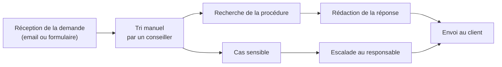
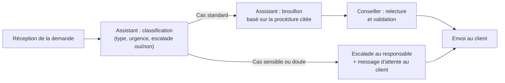

# Process : avant et après

> Schéma du client fictif. Le « après » est la cible à tester, pas un résultat mesuré.

## Process actuel (manuel)

## Process cible (avec l'assistant)

**Principe :** l'assistant ne répond jamais seul. Un humain relit chaque brouillon
et traite tous les cas sensibles.
